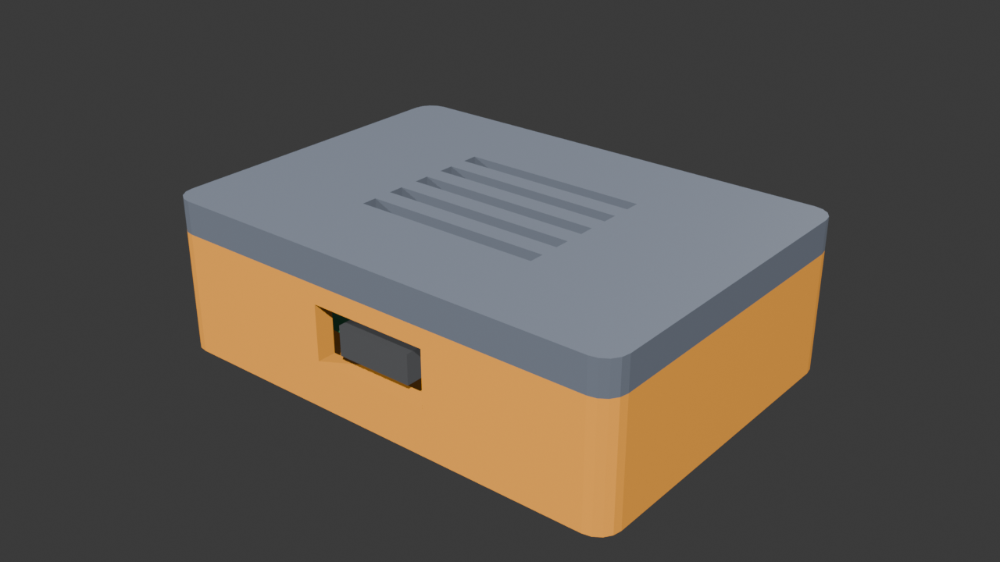
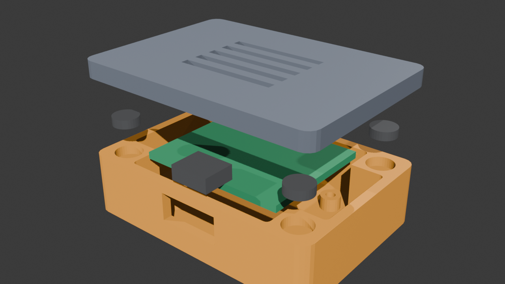

# Blender Studio for OrcaSlicer

<p align="center">
  
</p>

<p align="center">
  <b>Live Blender (:9999) Procedural CAD, Diagnostic Render-Inspect-Refine Studio, Hardware Mockups, AI CAD Assistant, and One-Click Send to Plate — directly inside an OrcaSlicer tab.</b>
</p>

<p align="center">
  <a href="QUICK_REFERENCE.md">Quick Reference</a> &bull;
  <a href="USER_GUIDE.md">Full User Guide</a> &bull;
  <a href="standalone/server_bootstrap.py">Standalone Server</a> &bull;
  <a href="LICENSE">MIT License</a>
</p>

---

**Blender Studio** is a zero-dependency, single-file **OrcaSlicer Pages Plugin** (`v1.2.1`) that connects OrcaSlicer directly to a live Blender instance over a main-thread TCP bridge (port `9999`). Instead of bouncing manually between Blender, file explorers, and your slicer, you can design or tweak 3D-printable parts procedurally with `bpy` (or an AI assistant with reference images & spec documents), inspect clearances with multi-angle and exploded EEVEE diagnostic renders, run a watertight manifold audit, and send binary STLs straight onto your active OrcaSlicer build plate in one click.

<p align="center">
  
  
</p>

*Sample enclosure (`Studio_Test_Pod.blend`) rendered inside Blender Studio — showing printable parts (`CAD_Printable_Parts`) alongside reference hardware mockups (`M_PCB_Board`, `M_USB_Port`, and `Mockup_Mag_0..3`) in Hero and Exploded diagnostic views.*

---

## Key Features

| Area | Capabilities |
| :--- | :--- |
| **Live Blender Bridge (`:9999`)** | Start a silent **Headless Daemon** (`--background`), launch the full **Blender GUI**, or connect to a **remote/Tailscale** Blender instance over TCP port `9999`. |
| **Zero-Dependency Single File** | Pure Python 3.10+ stdlib (`blender_studio.py`). No `pip` or `uv` package installs during OrcaSlicer startup. |
| **Printable vs. Mockup Separation** | Automatically separates printable CAD meshes (`Test_Pod_Base`, `Test_Pod_Lid`, etc.) from reference mockups (`M_*`, `Mockup_*`, `Vis_*`, `Plug_*`, `Hardware_Mockups`) with live `X × Y × Z mm` dimensions. |
| **Render-Inspect-Refine Viewport** | One-click **Hero**, **Top**, **Front**, **Isometric**, **Exploded**, and **Scene Cam** diagnostic renders via `BLENDER_EEVEE`, plus zoom controls and a saved project render filmstrip. |
| **AI CAD Assistant** | Injects live scene bounding boxes and hardware mockups into prompts for **Local Ollama** (`qwen2.5-coder:7b`, `qwen3.5-9b-vision`), **Google Gemini**, or any **OpenAI-Compatible** endpoint (OpenAI, OpenRouter, LM Studio, DeepSeek). Attach reference **pictures** (sketches, caliper photos, screenshots) and **documents** (`.md`, `.pdf`, `.txt`, `.py`, `.scad`, `.json`, `.csv`, `.svg`) via **`+ Image / Doc`**, drag-and-drop, or `Ctrl+V` clipboard paste, plus optional viewport image attachment and auto-run/render. |
| **Built-in 3D Printing Macros** | One-click macros for **3-Point Studio Rig**, **6×2 mm Magnet Pocket Mockup** (`Ø6.25 × 2.20 mm`), **M3 Boss & Captive Nut**, **SG90 Servo Mockup**, and **Manifold / Scale / Z-Floor Audit**. |
| **Cross-Platform Send to Plate** | Exports binary STL via `wm.stl_export` (`1 BU = 1 mm`) and delivers it straight onto the active **Prepare** build plate via Linux D-Bus (`AnotherInstance`), Windows `WM_COPYDATA`, or macOS single-instance handoff. |

---

## 60-Second Installation

### Prerequisites
- **OrcaSlicer v2.5.0+** (with Python `Pages` plugin support enabled)
- **Blender 4.2+ / 5.x** (tested on **Blender 5.2.0 LTS**)

### Install via OrcaSlicer UI (Recommended)
1. Download [`blender_studio.py`](blender_studio.py) from this repository.
2. Open **OrcaSlicer** &rarr; open **Plugins** &rarr; click **Install local plugin** and select `blender_studio.py`.
3. Restart OrcaSlicer (or reload plugins) and approve the local filesystem / localhost `:9999` / Blender executable permissions if prompted.
4. Click the new **Blender Studio** tab in OrcaSlicer's top navigation bar!

### Manual Side-Load Install
Copy `blender_studio.py` into your OrcaSlicer plugins directory under a matching folder name:
- **Linux:** `~/.config/OrcaSlicer/orca_plugins/blender_studio/blender_studio.py`
- **Windows:** `%APPDATA%\OrcaSlicer\orca_plugins\blender_studio\blender_studio.py`
- **macOS:** `~/Library/Application Support/OrcaSlicer/orca_plugins/blender_studio/blender_studio.py`

> **Tip:** Blender Studio automatically searches standard install paths for Blender across Windows, macOS, and Linux, or you can set a custom path in **Settings** inside the tab.

---

## Architecture Overview

```
+-----------------------------------------------------------------------+
|  OrcaSlicer (Top-Bar Pages Plugin: blender_studio.py)                 |
|  +------------------+  +--------------------+  +-------------------+  |
|  | Scene / Projects |  | Render Viewport    |  | AI CAD & bpy IDE  |  |
|  | & STL Library    |  | (Hero/Ortho/Expl.) |  | + Print Macros    |  |
|  +--------+---------+  +---------+----------+  +---------+---------+  |
|           |                      |                       |            |
|           +----------------------+-----------------------+            |
|                                  | TCP :9999 (4-byte len + UTF-8 JSON)|
+----------------------------------|------------------------------------+
                                   v
+-----------------------------------------------------------------------+
|  Blender 4.x / 5.x (server_bootstrap.py)                              |
|  - Headless Mode: Direct main-thread socket listener (--background)   |
|  - GUI Mode: Persistent bpy.app.timers main-thread queue (survives    |
|    bpy.ops.wm.open_mainfile across .blend switches)                   |
|  - Units: Metric 1 Blender Unit = 1.0 mm                              |
+-----------------------------------------------------------------------+
                                   |
                                   v  Binary STL -> D-Bus / WM_COPYDATA
                      [ OrcaSlicer Prepare Plate ]
```

---

## Documentation
- **[Quick Reference (`QUICK_REFERENCE.md`)](QUICK_REFERENCE.md)** — Cheat sheet for buttons, camera presets, macros, 3D-printing clearance tolerances, `bpy` snippets, and the `:9999` TCP protocol.
- **[Full User Guide (`USER_GUIDE.md`)](USER_GUIDE.md)** — Complete walkthrough covering setup, the Render-Inspect-Refine workflow, mockup conventions, AI CAD prompting, remote/Tailscale Blender servers, and troubleshooting.

---

## License
Released under the [MIT License](LICENSE) — Copyright (c) 2026 Gabrial McCauley (GDME LLC).
