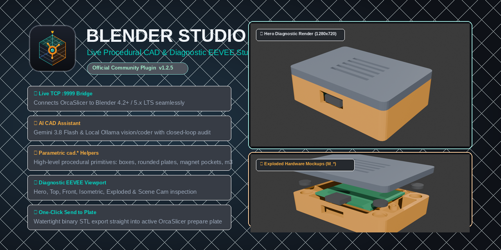
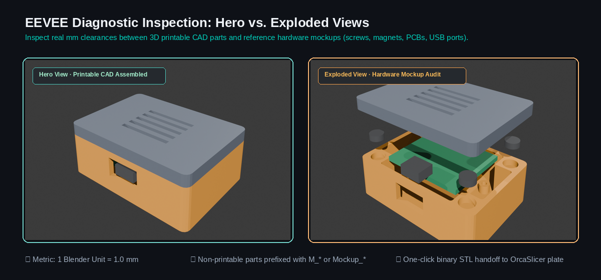

# Blender Studio for OrcaSlicer (v1.2.7)

  

  <b>Live Blender (:9999) Procedural CAD, Diagnostic Render-Inspect-Refine Studio, Hardware Mockups, Model Cutting & Plate Separation, AI CAD Assistant, and One-Click Send to Plate — directly inside an OrcaSlicer tab.</b>

  <a href="https://github.com/GDME-LLC/BlenderStudio">GitHub Repository</a> &bull;
  <a href="https://github.com/GDME-LLC/BlenderStudio/blob/main/QUICK_REFERENCE.md">Quick Reference</a> &bull;
  <a href="https://github.com/GDME-LLC/BlenderStudio/blob/main/USER_GUIDE.md">Full User Guide</a> &bull;
  <a href="https://github.com/GDME-LLC/BlenderStudio/blob/main/CHANGELOG.md">Changelog</a> &bull;
  <a href="https://github.com/GDME-LLC/BlenderStudio/blob/main/LICENSE">PolyForm Shield License 1.0.0</a>

---

## ✂ What's New in v1.2.7: Model Cutting & Multi-Plate Part Separation

Preparing oversized models or complex multi-shell STLs for slicing across multiple build plates is now effortless with Blender Studio v1.2.7:

- **Interactive `✂ Cut` Modal Dialog:** Click **`✂ Cut`** directly on any printable mesh in the left sidebar to open the cutting dialog with that model pre-selected.
- **Dual Cutting Modes:**
  - **Planar Slice (Bisect):** Slice along **Z** (horizontal height), **X** (lateral width), or **Y** (front-to-back depth). Use the interactive ratio slider (10% to 90%) or specify an exact millimeter offset.
  - **Separate Loose Shells:** Automatically detect and split disjoint, disconnected mesh bodies within multi-part STLs into individual objects.
- **Watertight Manifold Capping:** Automatic planar boundary hole-filling (`bmesh.ops.holes_fill`) and face normal recalculation guarantee **0 non-manifold edges** on all resulting halves.
- **Automatic Z-Floor Grounding (`Z=0`):** Both cut pieces are automatically lowered to rest flat on the build bed surface, preventing floating layers or slicer bed warnings.
- **Collision-Free Part Spacing:** Repositions parts side-by-side along the X-axis (default `25.0 mm` spacing) so both pieces are clearly visible and ready to send to separate build plates.
- **One-Click Execution or Script Inspection:** Click **`✂ Cut & Separate`** to execute immediately in Blender, or **`📝 To Editor`** to paste the generated Python code into the `bpy` editor for review and customization.
- **Procedural CAD Helpers:** Use `cad.cut_parts(target, axis="Z", ratio=0.5, offset=0.0, align_to_bed=True, spacing=20.0)` or `cad.separate_loose(target, align_to_bed=True, spacing=20.0)` directly in your own scripts.

---

## 📋 Complete Release Changelog

### [1.2.7] - 2026-11-21
#### Added & Enhanced
- **Interactive Cut & Separate Modal (`✂ Cut`):** Effortlessly split complex 3D models into watertight pieces or separate loose disconnected shells for independent build plates directly from the mesh sidebar.
- **Watertight Manifold Bisect & Capping:** Advanced planar bisecting with automated hole filling, face normal recalculation, and guaranteed 0 non-manifold edges.
- **Automatic Z-Floor Grounding & Part Spacing:** Automatically aligns cut parts flat against the build bed (`Z=0`) with configurable spacing (default `25mm`) for instant collision-free multi-plate slicing.
- **Built-in `✂ Cut` Macro (`cut_split`):** Instant macro button in the bpy script bar with fallback execution directly in Blender Python editor.
- **Procedural CAD Helpers:** Added `cad.cut_parts(...)` and `cad.separate_loose(...)` to the embedded `cad` library and exposed `bpy.cad`.
#### Fixed & Security
- Ensured full coordinate transform application (`location=True, rotation=True, scale=True`) prior to bisecting to guarantee 100% accurate planar positioning.

### [1.2.6] - 2026-11-20
#### Added & Enhanced
- **PolyForm Shield License 1.0.0:** Protects against competitive commercial misuse while keeping full free use for individual creators and users.
- **GNU GPL v3.0 (`GPL-3.0-or-later`):** Dedicated licensing for `standalone/server_bootstrap.py` for Blender `bpy` compatibility.
- **Dynamic Semver Metadata Validation:** Updated PEP 723 metadata with valid semver verification.
#### Fixed & Security
- Replaced hardcoded version test assertions with dynamic semver verification.

### [1.2.5] - 2026-11-20
#### Added & Enhanced
- **Orca Cloud Plugin Hub Certification:** Upfront capabilities declared via `orca.request_permissions(...)` for a single combined approval dialog on load.
- **100% Self-Contained:** Added **📋 Copy Bootstrap Script** and **💾 Export server_bootstrap.py** buttons inside Settings modal.
- **Automated CI/CD Pipeline:** Front-to-back GitHub Actions release pipeline with multi-OS distribution assets.
#### Fixed & Security
- Sanitized child process environments with `_ALLOWED_CHILD_ENV_KEYS`, eliminating sensitive credential leakage.
- Hardened outbound network requests with `_validate_safe_url` restricting calls strictly to HTTP/HTTPS schemes.

### [1.2.4] - 2026-11-18
#### Added & Enhanced
- **Parametric Procedural CAD Helpers (`cad.*`):** `box`, `rounded_plate`, `cylinder`, `tube`, `strut`, `oriented_box`, `counterbore_hole`, `slot`, `magnet_pocket`, `m3_hole`, `place_on_bed`, and `audit_geometry`.
- **Multi-Format CAD Attachments:** Attach `.step`, `.stp`, `.3mf`, and `.stl` files in the AI CAD Assistant.
- **Closed-Loop Geometry Audit:** Automatically inspects manifold status, isolated vertices, scale normalization, and bed clearance with AI self-healing.

### [1.2.3] - 2026-11-18
#### Added & Enhanced
- **Google Gemini 3.x Migration:** Integrated `gemini-3-flash-preview` and `gemini-3.8-flash-preview` with automatic failover.

### [1.2.2] - 2026-11-18
#### Added & Enhanced
- **Two-Stage Local Ollama Pipeline:** Vision model (`qwen3.5-9b-vision`) analyzes reference CAD/images; Coder model (`qwen2.5-coder:7b`) generates clean `bpy` code.
- **Built-in Server Self-Healing:** Automatically diagnoses and fixes `bpy` exceptions before reporting.

### [1.2.1] - 2026-11-18
#### Added & Enhanced
- Blender 5.2 LTS and 4.2+ LTS API compatibility shims.

### [1.2.0] - 2026-11-18
#### Added & Enhanced
- Multi-Modal AI CAD Assistant supporting image and specification document attachments.

---

## 🔍 Visual Diagnostics & Inspection

  

*Sample enclosure (`Studio_Test_Pod.blend`) rendered inside Blender Studio — showing printable parts (`CAD_Printable_Parts`) alongside reference hardware mockups (`M_PCB_Board`, `M_USB_Port`, and `Mockup_Mag_0..3`) in Hero and Exploded diagnostic views.*

---

## ⚡ Core Features

| Feature | Description |
| :--- | :--- |
| **Live Blender Bridge (`:9999`)** | Run silent **Headless Daemon** (`--background`), launch full **Blender GUI**, or connect over LAN/Tailscale. |
| **Zero External Dependencies** | Pure Python standard library (`blender_studio.py`). Zero pip runtime installations. |
| **Printable vs. Mockup Classification** | Automatically isolates printable CAD meshes from hardware/cable reference mockups with live dimensions. |
| **Interactive ✂ Cut Modal** | Planar slice along Z/X/Y or split loose shells into watertight manifold parts grounded flat on the build bed. |
| **Closed-Loop Geometry Audit** | Checks non-manifold edges, isolated vertices, floating islands, unapplied scale, and bed clearance. |
| **AI CAD Assistant** | Multi-modal CAD generation via Google Gemini 3.8 Flash, local Ollama (vision + coder), or OpenAI-compatible endpoints. |
| **One-Click Send to Plate** | Exports binary STL and delivers it straight into OrcaSlicer's active Prepare plate. |

---

## 🛡️ Upfront Permissions Notice

OrcaSlicer 2.5.0+ introduces fine-grained plugin security. Blender Studio declares all needed permissions upfront in a single approval dialog:
- **Local Sockets & Network (`network_socket`, `network_http`):** Bridge connection to Blender on `127.0.0.1:9999`, local Ollama on `127.0.0.1:11434`, and configured AI endpoints.
- **Filesystem Access (`fs_read`, `fs_readwrite`):** Your configured `3D Designs` project directory, OrcaSlicer `blender_studio` configuration, and temporary STL exports.
- **Process Spawning (`process`):** Execution of the local Blender executable (`blender`) and build plate handoff helpers (`gdbus`, `xdg-open`, `open`).
- **Threading (`threading`):** Background worker threads for responsive UI and non-blocking renders.

All child processes run with sanitized, allowlisted environment variables (`PATH`, `HOME`, `DISPLAY`, etc.)—never leaking system environment dictionaries or credentials.
